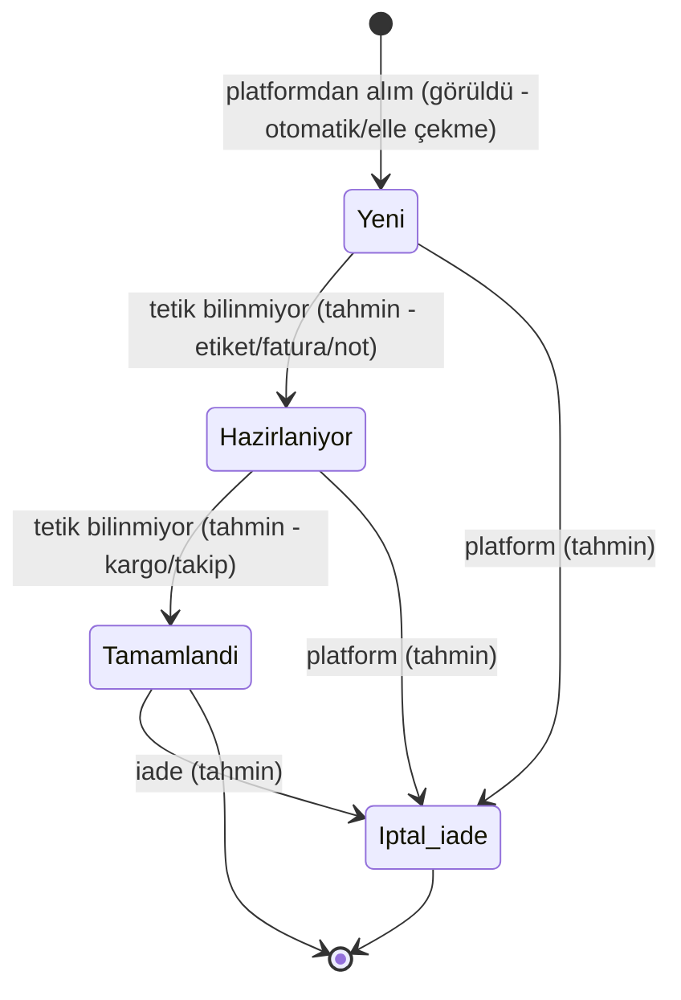
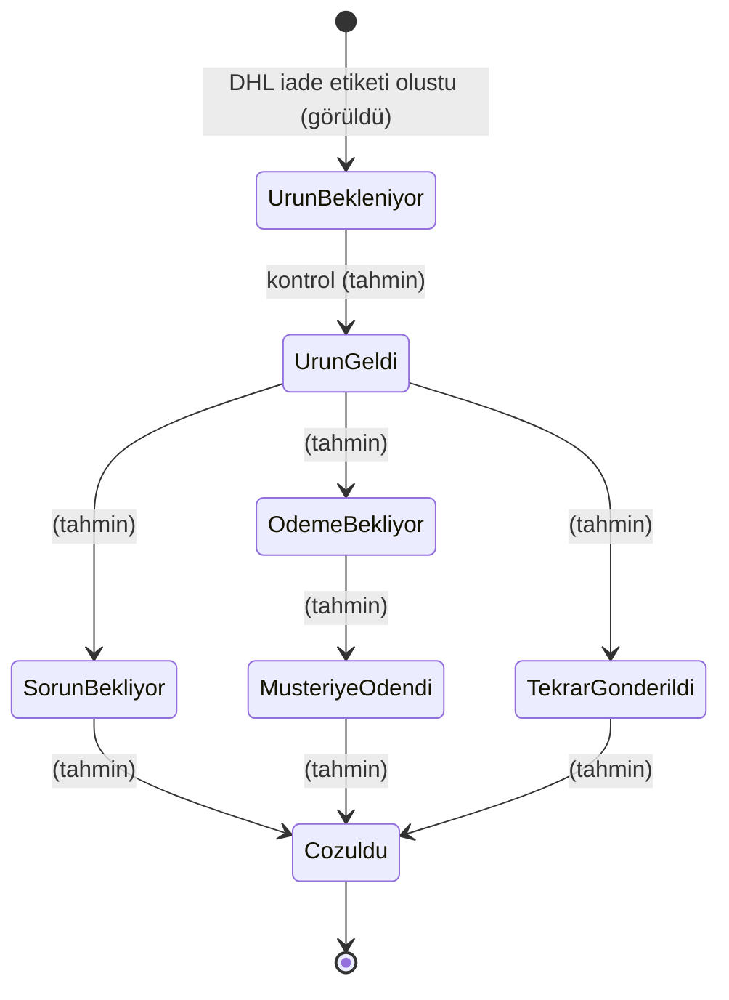
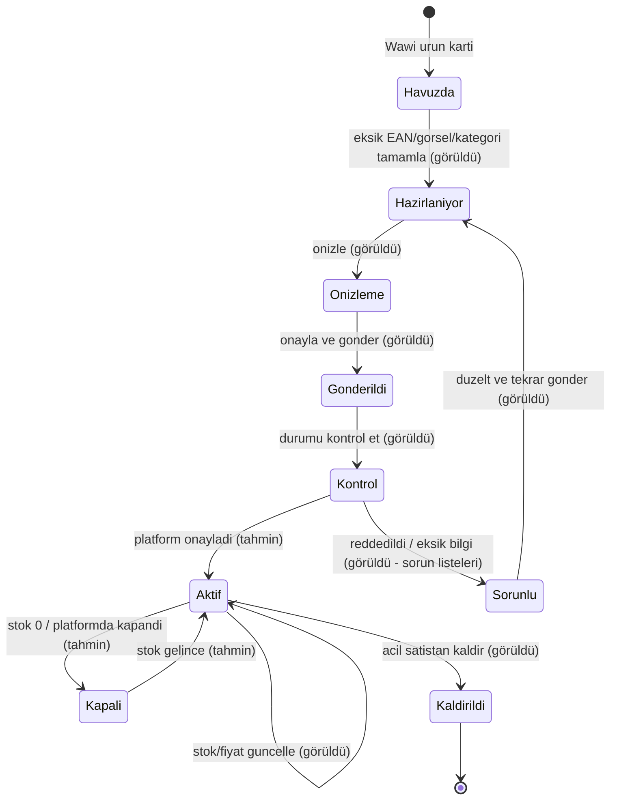
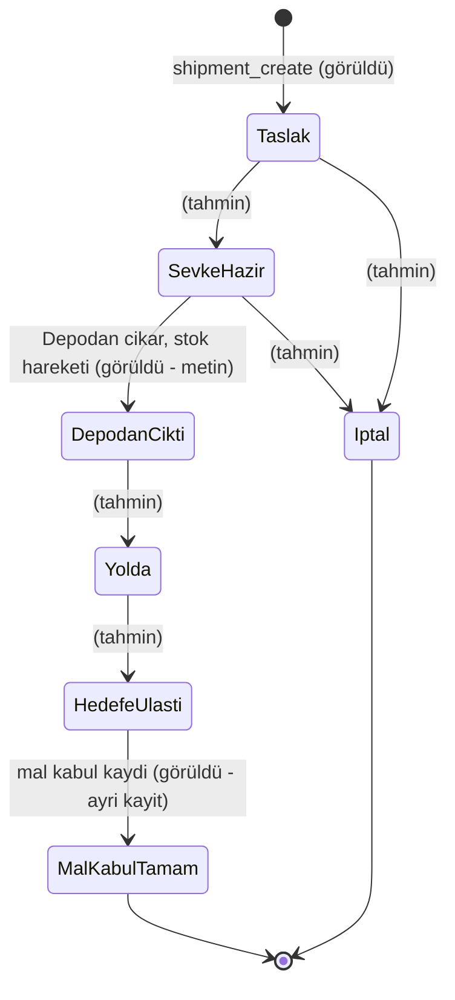
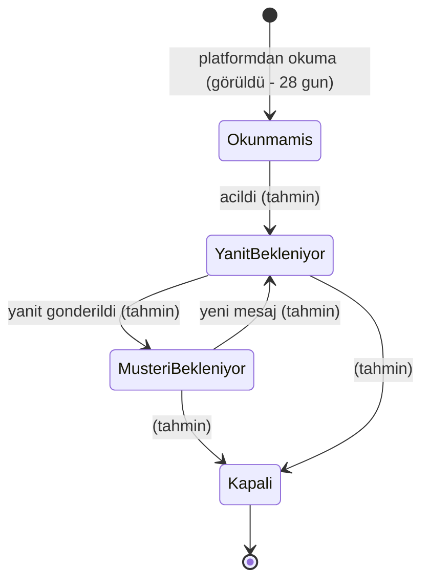
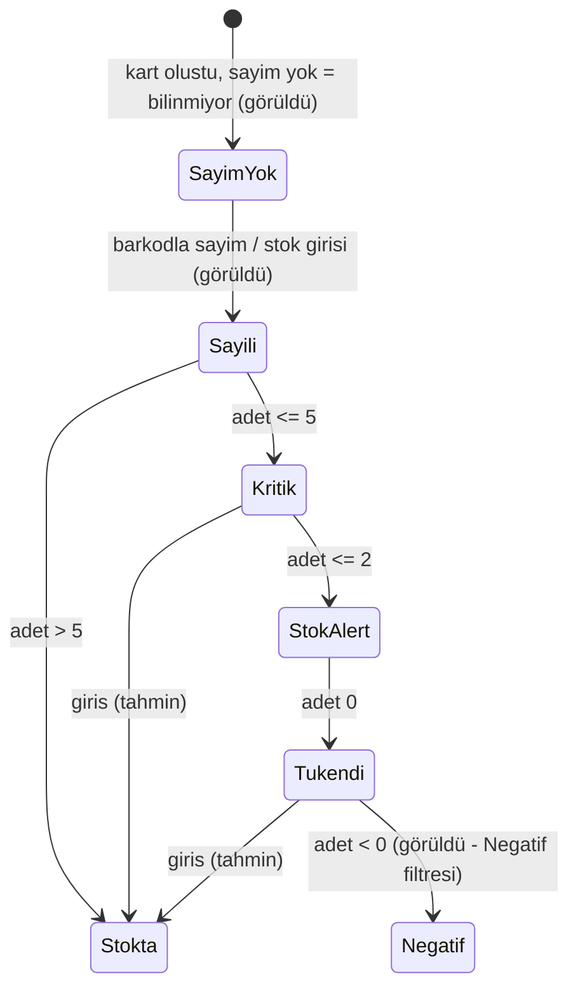
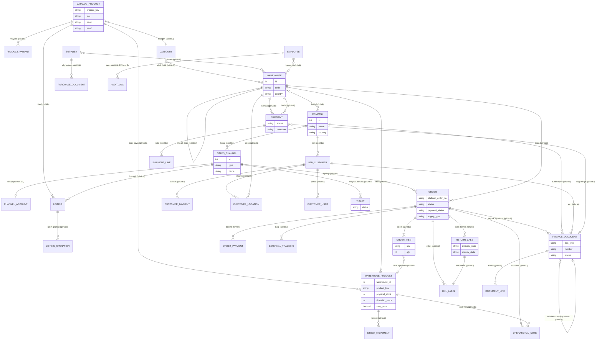

# WawiERP Alan Modeli — Varlıklar, Durum Makineleri, Tablo ve ER Taslağı

Tarih: 2026-11-14 · Kaynak: yalnız yerel belgeler (`docs/03-panel-analizi.md`, `docs/04-kavram-koprusu.md`, `docs/07-api-yuzeyi.md`, `raw/panel-harita.md`, `docs/panel/01…05`). Bu turda canlı siteye istek atılmadı.

**Uyarı: veritabanı şeması, sunucu kodu ve gerçek tablo adları görülmedi.** Aşağıdaki varlık, alan, ilişki ve tablo listesi ekranlardan, form alanlarından, `erp_action` adlarından ve ön yüz JS'inden çıkarımdır. ER diyagramı **kesin şema değil**, yeniden tasarım için bir taslaktır. Her satır "görüldü" (ekranda, formda veya JS'te doğrudan yazıyor) ya da "tahmin" (çıkarım) diye işaretlidir. Kişisel veri, tekil numara, bakiye, vergi no, PIN, token ve satıcı kimliği yazılmadı; yalnız alan adı ve biçim var.

## 1. Kimlik biçimleri

| Kimlik | Biçim | İşaret |
|---|---|---|
| Depo | Sayısal; 5 kayıt; kısa kod metin (MAIN, DE-WH, NL-WH, DE-MEGA-B, DE-TECHNOWELT) | görüldü |
| Şirket | Sayısal; adreste `company=` | görüldü |
| Kanal | Sayısal; adreste `channel=`; bir kanal = şirket + pazaryeri/platform + ad | görüldü |
| Hesap | Küresel sayısal; adreste `account=`; eBay işçi listelerinde `0` | görüldü |
| Ürün anahtarı `product_key` | Kaynağa göre: `manual:<özet>`, `sku:JTL-<sayı>`, `shopify:<sayı>:variant:<sayı>`, `ebay-account:<sayı>:<ilan>:<özet>`, `supplier:asterbuy:<özet>` (5 biçim; 13 kaynak) | görüldü |
| Depo ürün kaydı | Bileşik: `warehouse_id` + `product_key` | görüldü |
| Sipariş | Platform sipariş numarası (biçim platforma göre değişiyor; ortak iç numara görülmedi) | görüldü (platform no), tahmin (iç kimlik yok) |
| Satış faturası | `RE-<şirket kodu>-<yıl>-<6 hane>`; eski ön ek `WAWI-<şirket kodu>-<yıl>-<6 hane>` | görüldü |
| İade faturası | `RET-<sipariş no>-<n>` | görüldü |
| Çıkış belgesi (şirketler arası, sevk) | Serbest girilen numara (zorunlu alan) | görüldü |
| B2B cari kodu | `customer_code`; gözlenen biçim `RET-INV-<n>` (iade numarasından türetilmiş görünüyor) | görüldü (biçim), tahmin (türetme) |
| Belge ayrıntısı | `finance_document=<sayısal id>` | görüldü |
| Eşleşme / işlem tekrarı | Tarayıcıda 16 bayt rastgele idempotency anahtarı; depo eşitlemede gizli alan `request_key` | görüldü |
| Denetim kullanıcısı | Çalışan adı varsa ad; yoksa PIN'in yalnız son 2 hanesi | görüldü |
| Asterbuy siparişi | Tedarikçi tarafında ayrı numara ("Asterbuy #…") | görüldü |
| Kanal ilanı | eBay ilan no + eBay SKU; Wawi tarafı SKU (eBay'de `WAWI-<kanal>-…` otomatik SKU'lar), `platform_sku` kanal başına | görüldü |
| Ticket, iade kaydı, sevkiyat, not, stok hareketi, DHL etiketi | Kimlik biçimi görülmedi | bilinmiyor |

## 2. Varlıklar

### 2.1 Yapı: depo, şirket, kanal, hesap
| Varlık | Alanlar | İlişkiler | İşaret |
|---|---|---|---|
| Depo | id, ad, kod, ülke, adres, telefon, renk, ikon, ana/alt depo ilişkisi, son eşitleme durumu | Ana depo (İstanbul) → alt depolar (Almanya, Hollanda, Mega B, Technowelt); depo ↔ şirket çoktan çoğa (bir şirket birden fazla depoya bağlanabiliyor) | görüldü |
| Şirket | id, görünen ad, yasal unvan, ülke, kayıt/vergi no (yazılmadı), iletişim (yazılmadı), atanan depo, veri kaynağı, kanal sayısı | Şirket → kanallar; şirket → faturalar (düzenleyen); şirket → B2B cariler | görüldü |
| Kanal | id, tür (eBay, Kaufland, Amazon, METRO, OTTO, Shopify, JTL-Shop, JTL-Wawi, XML-Import, Dealclub, Ozon, Trendyol, N11, webshop), ad, katalog durumu, sipariş durumu, ürün kaydı, satış stoku | Kanal → şirket, kanal → hesap | görüldü |
| Hesap | global id, kanal, kimlik bilgileri (şifreli; yazılmadı), para birimi (Ozon USD, Trendyol/N11 TRY, diğerleri EUR), son okuma zamanı, arka plan işi durumları | Bir şirketin bir kanalı için tek hesap (tahmin) | görüldü, ilişki sayısı tahmin |
| Kanal-şirket ataması | `company_channel_id` (gizli form alanı) | Şirket × kanal bağ tablosu | görüldü |

### 2.2 Ürün ve stok
| Varlık | Alanlar | İlişkiler | İşaret |
|---|---|---|---|
| Ürün kartı (katalog, ≈232,5 bin) | `product_key`, başlık, kaynak, SKU, EAN 1, EAN 2, marka, kategori, renk, beden, `weight_grams`, açıklama, etiketler, eBay/Google/Shopify başlıkları (80/150/255 karakter sınırı), görseller (galeri), `attributes_json`, güvenlik/SDS alanları (SDS adresi, uyarı kelimesi, H/P kodları, INCI), veri durumu (Yeni, Değişmedi, Stok Değişti, Fiyat Değişti…), paket kuralı | Kart → depo ürün kayıtları; kart → varyantlar; kart → ilanlar | görüldü |
| Depo ürün kaydı (≈151 bin) | `warehouse_id`, `product_key`, `sale_price` (KDV dahil), `dropship_sale_price`, `physical_stock`, `dropship_stock`, `minimum_stock`, `bin_location`, Depo EAN 3 (`ean3`), sanal stok açık/kapalı, tedarikçi | Kart × depo | görüldü |
| Varyant | Opsiyon adı, kart adı, SKU, EAN 1/2, görsel; ana kart altında | Varyant → ürün kartı; ayrı kart mı, alt kayıt mı belirsiz | görüldü (alanlar), tahmin (modelleme) |
| Paket kuralı | `is_pack`, `units_per_item` ("1 satışta stoktan düşen adet") | Depo ürün kaydı | görüldü |
| Platform SKU | `platform_sku`, `company_channel_id` | Ürün × kanal | görüldü |
| Kategori | Ad, renk, ürün sayısı, depo görünürlüğü (`visible_warehouse_ids[]`); 411 kategori (katalog yönetimi), 1.139 (ürün sayfası) | Kategori × depo görünürlük; ürün → kategori | görüldü; iki sayının farkı açıklanamadı |
| Marka | 3.979 farklı değer | Ürün → marka (ayrı tablo mu, metin mi belirsiz) | görüldü (sayı), bilinmiyor (tablo) |
| Stok türleri | Fiziki (sayılan; "Sayım yok" = bilinmiyor), Drop (Wawi alanı), Sanal (platform adedini etkileyen anahtar), Tedarikçi API stoğu, Paket stoğu | Depo ürün kaydı üzerinde alan veya ayrı sayaç | görüldü (kavramlar), tahmin (depolanma) |
| Stok hareketi | Ürün, tarih/işlem, depo/kaynak, fiziki stok önce → sonra, değişim, kullanıcı, sipariş referansı; "önceki miktar kayıt yok" olabilir | Hareket → depo ürün kaydı | görüldü (ekran sütunları) |
| Sipariş stok işlemi | "Bekleyen sipariş stok işlemi", 106 açık kayıt | Sipariş → stok düşümü | görüldü (sayaç), tahmin (varlık) |
| Stok dağıtım kaydı | Ürün, hedef depo, adet, tarih, işlemi yapan | İstanbul → alt depo | görüldü |
| Sayım kaydı | Depo, işlemi yapan, okutulan SKU/EAN, adet, yöntem (ekle/ayarla) | Depo ürün kaydı | görüldü (form), kayıt biçimi bilinmiyor |
| Tedarikçi | Ad, yasal unvan, vergi/kayıt no, ülke, iletişim, not; alım, fatura, ürün satırı, belge adedi | Tedarikçi ↔ depo; tedarikçi → alış belgeleri | görüldü |
| Alış belgesi | Fatura veya irsaliye, ödeme durumu (Ödenmedi görüldü), PDF/görsel | Tedarikçi → belge | görüldü |
| Asterbuy fiyat kuralı | `shipping_net`, `profit_net`, `fee_percent`, `return_percent`, `vat_percent`, `rounding`, `processing_days` | Tedarikçi/kanal ayarı (METRO yeni ilan) | görüldü |
| Operasyonel not (sorun) | Tür: sipariş veya ürün (`kind=order`); neden (çoklu), not, durum, yazan, zaman, dosyalar (PDF/PNG/JPG/WebP, 8 MB, en çok 5), düzenleme geçmişi, yanıt dizisi | Not → sipariş veya ürün | görüldü |

### 2.3 İlan ve kanal
| Varlık | Alanlar | İlişkiler | İşaret |
|---|---|---|---|
| İlan (listing) | Kanal, hesap, platform ilan no, platform SKU, platform EAN/GTIN, kategori (eBay: "Alınmadı" olabilir), durum (kanala göre), platform fiyatı, platform adedi, yayın tarihi, stok deposu, Wawi eşleşmesi (eşleşti / eşleşmedi / gerekli / Wawi yayın kaydı yok) | İlan → ürün kartı (eşleşmeyenler dahil; ilanın kopyası iki satır olabiliyor) | görüldü |
| İlan işlem geçmişi | Ürün, işlem (`publish`, `withdraw`, `auto_stock_policy`), durum (Tamamlandı), tarih, hata kodu; eBay Woida'da 1.176 kayıt | İlan/ürün → işlem | görüldü |
| Gönderim önizlemesi / onayı | Önizle → onayla kaydı ("Gönderim ve EAN onay kayıtları"), Kaufland teklifi: `price`, `amount`, `handling_time`, `id_warehouse`, `id_shipping_group`, `condition`, `vat_indicator` | İlan | görüldü |
| Trendyol/N11 fiyat-stok değişikliği | `salePrice`, `listPrice`, `quantity` | İlan | görüldü |
| Pazaryeri satış durdurma | Önizle/uygula/durum; mağaza başına | İlan | görüldü (JS) |
| Eşleşmeyen ürün | İndirme listesi ("Eşleşmeyenler") | Kaynak → kart | görüldü (düğme), alanları bilinmiyor |

### 2.4 Sipariş, kargo, iade, destek
| Varlık | Alanlar | İlişkiler | İşaret |
|---|---|---|---|
| Sipariş | Platform sipariş no, kaynak (platform: JTL, Amazon, eBay, JTL Shop, Kaufland, Web mağazaları, Shopify, METRO, diğer), kanal/mağaza, şirket, depo, müşteri (ad, teslimat adresi, e-posta, telefon: yazılmadı), tarih, tutar + para birimi, ödeme yöntemi, ödeme durumu, sipariş durumu, tedarik tipi, gönderim durumu (türetilmiş), etiket durumu, takip, not/sorun | Sipariş → kalemler; sipariş → etiket; sipariş → fatura; sipariş → notlar; sipariş → şirket/depo/kanal | görüldü |
| Sipariş kalemi | Başlık, satış anındaki ad, SKU, EAN, adet, (tutar) | Kalem → depo ürün kaydı | görüldü |
| Tedarik tipi | `physical`, `dropship`, `asterbuy`, `bueroarena`, `b2buhren`, `watchimport` | Sipariş (veya kalem) alanı; karma siparişte paketler ayrı | görüldü; kalem/sipariş düzeyi belirsiz |
| Ödeme kaydı | Yöntem (kredi/banka kartı, SEPA, PayPal, Klarna, iDEAL, Apple Pay, Bancontact), durum (Ödendi, Provizyon, Kısmen ödendi, Kısmen iade, İade edildi, Ödeme iptal), tahsilat/iade tutarı; Mollie kayıtları Shopify'dan geliyor | Ödeme → sipariş | görüldü |
| Müşteri (sipariş içi) | Ad, adres, e-posta, telefon; müşteri sayısı tekil sayılıyor ("24.091 tekil") | Ayrı müşteri tablosu mu, sipariş içinde mi belirsiz | görüldü (tekil sayı), bilinmiyor (modelleme) |
| DHL etiketi | Gidiş etiketi ve ayrı iade etiketi, durum (hazır / oluşturulamadı / PDF hazır), ücretli, yeniden oluşturma, ağırlık/ayar, adres düzeltme, `X-Request-ID`; siparişsiz etiket (manual) | Etiket → sipariş (siparişsiz olabilir) | görüldü |
| Harici takip | Taşıyıcı (DHL, DPD, GLS, Hermes, UPS, FedEx, PostNL), takip no, doğrulama | Takip → sipariş | görüldü |
| Asterbuy siparişi | Durum, tedarikçi sipariş no, takip (taşıyıcı + tarih) | Asterbuy → sipariş | görüldü |
| İade | Sipariş, şirket · mağaza, ürün, depo, iade takip no, iki ekseni (teslim, para), "Henüz kontrol edilmedi"; iade sebebi ve tutarı sütunu yok | İade → sipariş; iade → DHL iade etiketi; iade faturası ayrı | görüldü |
| Ticket | Mağaza, konu/ilk satır, zaman, durum; mesaj dizisi (yanıt formu görülmedi) | Ticket → kanal/mağaza | görüldü (liste), mesaj yapısı bilinmiyor |
| Depo mesajı | Depolara gönderilen mesaj (`message_action=send`), `warehouse-messages.php` | Mesaj → depo | görüldü (form adı), alanlar bilinmiyor |
| Depolar arası sevkiyat | Kaynak depo, hedef depo, bağlı sevk belgesi/şirketler arası fatura, taşıma şekli (Hava/Kara/Deniz), tahmini varış, taşıyıcı, takip no, not, ürün satırları (ürün anahtarı, planlanan adet), durum | Sevkiyat → belge; sevkiyat → stok hareketi (çıkış) ve mal kabul kaydı | görüldü |

### 2.5 Finans
| Varlık | Alanlar | İlişkiler | İşaret |
|---|---|---|---|
| Çıkış belgesi (satış faturası, şirketler arası fatura, depo sevk belgesi) | Tür (`sales_invoice`, `intercompany_invoice`, `warehouse_dispatch`), düzenleyen şirket, numara, tarih, vade, para birimi (EUR/TRY/USD/GBP), durum (taslak/kesin), hedef depo, alıcı şirket, alıcı adı/vergi no/e-posta/adres, not, sorumlu (PIN), kaynak sipariş no | Belge → kalemler; belge → sipariş; belge → şirket | görüldü |
| Belge kalemi | ERP ürünü, açıklama, miktar, net birim fiyat, KDV %, toplam (brüt); en fazla 50 satır | Kalem → belge, kalem → ürün | görüldü |
| İade faturası | Satış faturasına bağlı, negatif tutar, `RET-` numarası; iptal edilebiliyor; defterde sevk belgesi türünde | İade faturası → satış faturası, sipariş | görüldü (alanlar), tahmin (türe bağ) |
| Tedarikçi faturası | Numara, tarih, tedarikçi, tutar, ödeme durumu, PDF/görsel | Tedarikçi | görüldü |
| Kargo faturası | DHL/PostNL gider faturası (0 kayıt) | — | görüldü (tanım), kayıt yok |
| Fatura posta/e-posta ayarı | SMTP ayarları (`mail_settings`, `save_mail`, `test_mail`, `send`) | Şirket veya sistem (belirsiz) | görüldü (eylemler), bilinmiyor (alanlar) |
| Pazaryeri fatura aktarımı | Kuyruk durumu (queued, checking, creating, Metro'ya gönderiliyor, doğrulanıyor), işlem günlüğü, yeniden dene | Aktarım → fatura, sipariş | görüldü (JS) |
| B2B cari (müşteri) | Görünen ad, yasal ad, vergi no, sicil no, e-posta, telefon, fatura adresi, `customer_code`, şirket, aktif | Cari → şirket; cari → faturalar, tahsilatlar, lokasyonlar, portal kullanıcıları | görüldü |
| Cari lokasyonu | Kod, ad, depo, adres | Lokasyon → cari, depo | görüldü |
| Portal kullanıcısı | Ad, giriş e-postası, parola, `can_adjust_stock` | Kullanıcı → cari | görüldü |
| Tahsilat | Tarih, para birimi (EUR/TRY/USD/GBP/CZK/PLN), tutar, referans, açıklama | Tahsilat → cari | görüldü |
| Cari bakiyesi | Borç = satış faturaları − tahsilatlar; para birimi başına ayrı | Türetilmiş | görüldü |
| Toptan satış taslağı/kaydı | Cari, satıcı şirket, stok çıkış deposu, ürünler, durum (taslak, kesin, iptal), KDV varsayılan 19 | Satış → cari, belge | görüldü (adımlar), tablo bilinmiyor |
| Banka içe aktarma | ≤5 MB CSV; tarama, eşleştirme, uygulama | İçe aktarma → sipariş ödemesi (Shopify havale) | görüldü (JS) |

### 2.6 Yönetim
| Varlık | Alanlar | İlişkiler | İşaret |
|---|---|---|---|
| Çalışan | Kısaltma, ad, rol etiketi, kapsam etiketleri, PIN durumu (aktif / ayarla), depo adları; giriş e-posta+şifre veya PIN | Çalışan ↔ depo (kapsam); çalışan → rol | görüldü; PIN/e-posta birleşimi bilinmiyor |
| Rol | Sistem yöneticisi, Kategori atama yöneticisi, Kategori sorumlusu, Depo sorumlusu, Depo çalışanı, Wawi operasyon, Ürün giriş operatörü | Çalışan → rol; granül görev izni yok | görüldü |
| Denetim kaydı | Tarih/saat, sonuç (success/failure/denied), önem (info/warning/error/critical), kategori (8), olay adı, modül, kullanıcı (PIN son 2), oturum türü, depo · şirket, kaynak, nesne türü (`outbound_document`…), IP, ağ geçidi; saklama işlem 180 gün, hata 30 gün; 83.070 satır | Kayıt → çalışan, depo, nesne | görüldü |
| Eşitleme işi | Depo başına stok+sipariş güncelleme, durum (Henüz güncellenmedi / Güncelleme tamamlanamadı / tamamlandı), son işlem zamanı; kanal başına arka plan işleri (sipariş alımı, ürün aktarımı, stok/fiyat otomasyonu); fiziki stok eşitleme ilerlemesi | İş → depo/kanal | görüldü |
| Belge özellik kataloğu | 28 modül, 20 hazır, 8 hazırlanıyor | — | görüldü |

## 3. Durum makineleri

Her geçiş için tetikleyici belgelerde çoğunlukla **yok**; yazılanlar "görüldü", çıkarılanlar "tahmin". Geçiş oku "gözlenen" değil, "durum değerlerinin listelenme sırası" olduğunda ayrıca belirtilmiştir.

### 3.1 Sipariş
Sipariş durumu değerleri: Yeni, Hazırlanıyor (eBay/Kaufland'da "İşlemde"), Tamamlandı, İptal/iade (görüldü). Trendyol/N11 genişletilmiş seti: Yeni, Hazırlanıyor, Faturalandı, Kargoda, Teslim edildi, İptal, İade, Teslim edilemedi, Ödeme bekliyor, Paket bölündü; OTTO: Hazırlanacak, Gönderildi, İptal (görüldü). Geçişin **tetikleyicisi ekranda görünmedi** (görüldü, `docs/panel/01`). Aşağıdaki oklar liste sırasından çıkarım (tahmin).

Yan eksenler (görüldü): **Ödeme**: Ödendi, Kartla ödendi, Havaleyle ödendi, Banka havalesi bekleniyor, Ödeme bekleniyor, Kısmen ödendi, İade edildi, Kısmen iade edildi, Ödeme iptal edildi, Ödeme başarısız, Ödeme süresi doldu. **Gönderim**: gönderilmeyen, 2 günü aşan (süreye göre türetilmiş görünüyor, tahmin). **Etiket**: oluşturulamayan, bugün oluşturulan, hazır PDF. **Fatura hattı**: sipariş kartında `order_pipeline_states` (JS; değerleri bilinmiyor).

Asterbuy siparişi (görüldü): Oluşturulacak → Ödeme bekliyor → Takip bekliyor/aktarılıyor → Takip aktarıldı; ek "Kontrol edilecek" (hata/inceleme, tahmin). Tetikler: yeni siparişler 5 dakikada bir kontrol, takip no 4 saatte bir alınıp kanala işlenir (görüldü).

### 3.2 İade
İki eksen (görüldü): **teslim** — Müşteriden ürün bekleniyor → Ürün geldi (kontrol: "Henüz kontrol edilmedi"); **para** — Ödeme bekleyen → Müşteriye ödendi; ek durumlar Tekrar gönderildi, Sorun bekleyen, Geciken; son: Çözülen. Doğuş tetikleyicisi: DHL iade etiketi (görüldü). Başka geçişler hiç gözlenmedi: 79 kaydın tamamı ilk durumda (görüldü). Kalan oklar liste sırasından (tahmin). "Durum kaydı stok, fatura veya para hareketi oluşturmaz" (görüldü).

"Geciken" bir durum mu, süreye bağlı türetilmiş süzgeç mi belirsiz (tahmin: süzgeç).

### 3.3 İlan
Kanal başına değer kümesi farklı (görüldü): eBay — Aktif, Stok 0 · satışa kapalı, Durumu belirsiz, Kapanmış, Bekleyen, Kontrol gerekli; Kaufland — Aktif, Aktif ilanı olmayan, Kapalı/pasif, Kaufland'da olmayan; sorun türleri Eksik/reddedilen bilgi, Kaufland onayı bekleniyor, Satış engeli; METRO — Aktif, Kaldırılmış, Duraklatılmış, Pasif, Henüz teklif yok; OTTO — Satışta, Otto onayı bekliyor, Reddedildi, Kısıtlı, Henüz doğrulanmadı; Shopify — aktif, pasif, bağlı değil, bilinmiyor (+ yayın seçimi Taslak/Aktif); Ozon — Aktif, Stok yok, Hazır, İncelemede, Hatalı, Arşiv; Trendyol — Satışta, Onaylı · satışta değil, Onay sürecinde, İnceleme gereken, Kaynakta bulunamadı. Aşağıda ortak iskelet (görüldü: düğme dizisi `docs/panel/03`); gerçek geçiş tetikleyicileri düğmelerdir (görüldü), otomatik geçişler (platform onayı, kapanma) tahmin.

Not: "yalnız kaydet" ve "pazaryerine gönder" ayrı düğmeler; kaydet ilanı değiştirmez (görüldü). Gönderim zaman aşımında sonuç bilinmez; "tekrar göndermeden durumu kontrol edin" (görüldü). METRO'da ürün verisi onayı ile teklif iki ayrı aşama; Kaufland'da kategori/bilgi → durum → teklif (görüldü). Otomatik stok politikası aynı ürün için gün içinde birkaç kez `auto_stock_policy` yazıyor (görüldü); tetik koşulu bilinmiyor.

### 3.4 Fatura
Satış ve iade faturası durumları: Taslak (draft), Kesinleştirildi (issued), İptal (cancelled) (görüldü). Tetikleyiciler: siparişten oluştur (`task=prepare`, JS `prepare_order`/`create_order_draft`/`issue`), düzenle (`edit_save`), gönder (`send`), iade (`return_create`), iade iptali (`return_cancel`) (JS eylem adları: görüldü; hangisinin hangi durumu yaptığı tahmin). İlk sayfada 25 satırın hepsi Kesinleştirildi (görüldü). Mevcut fatura varsa ikinci kez oluşturulmaz (görüldü).

```mermaid
stateDiagram-v2
    [*] --> Taslak : siparisten hazirla / elle (görüldü)
    Taslak --> Kesinlestirildi : issue / finalize (tahmin - eylem adindan)
    Taslak --> Iptal : cancel (tahmin)
    Kesinlestirildi --> Kesinlestirildi : duzenle edit_save (görüldü), PDF/gonder
    Kesinlestirildi --> IadeFaturasi : return_create (görüldü)
    IadeFaturasi --> IadeIptal : return_cancel (görüldü)
    Kesinlestirildi --> Iptal : (tahmin; Iptal durumu filtrede var)
    Iptal --> [*]
```

Pazaryeri fatura aktarımı (ayrı mini makine, JS: görüldü): kuyrukta (queued) → kontrol (checking) → oluşturuluyor (creating) → Metro'ya gönderiliyor → doğrulanıyor → bitti/hata; yeniden dene (tahmin: bitiş durumları). Elle çıkış belgesi (`add_outbound_document`) taslak veya kesinleştirilmiş doğrudan kaydedilebiliyor (görüldü).

### 3.5 Sevkiyat (depolar arası)
Durumlar (görüldü): Taslak, Sevke hazır, Depodan çıktı, Yolda, Hedef depoya ulaştı, Mal kabul tamamlandı, İptal edildi. Görülen tetik: `shipment_create` taslak açar; stok hareketi "Depodan çıkar" adımında oluşur ve mal kabul ayrı kayıttır (sayfa metni: görüldü). Liste boş olduğundan diğer geçişlerin düğmeleri görülmedi (görüldü).

### 3.6 Ticket
Durumlar (görüldü): Yanıtımız bekleniyor (open), Müşteri/platform bekleniyor (waiting), Kapalı/yanıtlandı (closed), Okunmamış (unread — durum mu işaret mi belirsiz). Satırda durum rozeti görülmedi; "Okunmamış" ayırt edilemiyor (görüldü). Geçişler tamamen tahmin: yanıt gönderince `open → waiting`, müşteri cevabı gelince `waiting → open`, kapanış `closed`. Yanıt akışı görülmedi.

Sayı çelişkisi: genel bakış 450 açık, `tickets` ≈3.400 kayıt (kapalılar dahil, son 28 gün) (görüldü).

### 3.7 Stok hareketi ve stok durumu
Stok hareketi bir durum makinesi değil, değişmez kayıt satırıdır (görüldü: önce → sonra, değişim). Görülen hareket kaynakları: manuel ekleme (`add_stock`), hızlı düzenleme, toplu düzenleme, CSV içe aktarma, barkodla sayım (ekle veya ayarla), dağıtım (İstanbul → alt depo), alt depodan merkeze çekim, sipariş stok işlemi, depodan çıkış (sevkiyat), kanal "Stoğu güncelle" seçeneği "Fiziki + kanal" (görüldü, çoğu eylem adı). Hareket türü sözlüğü ve "Hareket" açılır listesi görülmedi.

Fiziki stok durumu etiketleri (türetilmiş, görüldü): Stok var, Stok 0, Sayım yok, Negatif, Kritik (≤5), Stok Alert (≤2). Fiziki stok kontrolü durumları (görüldü): Düzeltme gerekenler, Uyumlu, Adet farklı/gecikmiş, Senkron bekliyor, İşlem engeli, Güncel okuma gerekli, Aktif ilan yok.

Geçiş koşulları eşiklerden (görüldü); "SayimYok → Sayili" tetikleyicileri sayım ve stok girişi (görüldü); diğer oklar türetilmiş eşik değişimi (tahmin).

Eşitleme işi (görüldü, durum değerleri; geçişler tahmin): Henüz güncellenmedi → Sırada → Çalışıyor → Güncelleme tamamlandı veya tamamlanamadı; tüm depolarda şu an "tamamlanamadı" veya "henüz güncellenmedi" (görüldü).

### 3.8 Diğer küçük durum makineleri
- **Operasyonel not**: Açık (İşlem bekliyor) → Çözüldü; çözülen konuşmalar 10 gün saklanır (görüldü). Yeniden açma bilinmiyor.
- **DHL etiketi**: hazırlanmadı → hazır / oluşturulamadı → PDF hazır → yeniden oluşturma; gidiş ve iade etiketi ayrı (görüldü: durum adları; geçişler tahmin). Zaman aşımında "otomatik tekrar yok, durumu kontrol edin" (görüldü).
- **Satın alma akışı** (görüldü, 4 adım): Tedarikçi kartı → Alış belgesi → Mal kabul → Ödeme kontrolü; tedarikçi faturası ödeme: Ödenmedi (diğer değerler görülmedi).
- **Mükerrer birleştirme**: aday → 2–20 seçim → önizleme → onay (metin + yönetim PIN) → birleşti; geri alma yok (görüldü).
- **Katalog arşivi**: aktif → arşivli (görünümden kaldırılır; stok, eşleşme, fatura, hareket korunur) (görüldü).

## 4. Olası tablo listesi (tahmin)

Gerçek tablo adı bilinmiyor; adlar önerilen/uydurma değil, rolü anlatan etiketlerdir. "Dayanak" sütunu hangi gözlemden çıkarıldığını söyler.

| # | Olası tablo | Dayanak | İşaret |
|---|---|---|---|
| 1 | warehouses | `warehouses`, `add_warehouse` | tahmin |
| 2 | companies | `add_company`, `company-home` | tahmin |
| 3 | warehouse_companies | Şirket ↔ depo çoktan çoğa | tahmin |
| 4 | sales_channels (company_channels) | `company_channel_id` gizli alanı | görüldü (alan), tahmin (tablo) |
| 5 | channel_accounts | hesap kimliği, `connector-test` | tahmin |
| 6 | catalog_products | 232.5 bin kart, `product_key` | tahmin |
| 7 | warehouse_products | 151 bin depo kaydı (`warehouse_id`+`product_key`) | tahmin |
| 8 | product_variants | Varyant sekmesi | tahmin |
| 9 | product_images | `gallery_files`, galeri adedi | tahmin |
| 10 | product_platform_skus | `save_product_platform_sku` | tahmin |
| 11 | stock_pack_rules | `save_stock_pack_rule` | tahmin |
| 12 | categories | `add_category` | tahmin |
| 13 | category_warehouse_visibility | `save_category_visibility` | tahmin |
| 14 | brands | 3.979 değer | tahmin (tablo mu metin mi belirsiz) |
| 15 | stock_movements | `stock-movements` | tahmin |
| 16 | stock_distributions | `preview_stock_distribution`, hareket geçmişi | tahmin |
| 17 | stock_counts | `barcode-count` | tahmin |
| 18 | order_stock_operations | "106 açık sipariş stok işlemi" | tahmin |
| 19 | suppliers, supplier_warehouses | `add_supplier`, depoya bağlama | tahmin |
| 20 | purchase_documents (+ lines) | `attach_purchase_document`, alış belgeleri | tahmin |
| 21 | supplier_catalog (Asterbuy API kataloğu) | 796 ürün, eşleşme durumu | tahmin |
| 22 | listings | kanal ilanları, eşleşme durumu | tahmin |
| 23 | listing_operations (history) | `publish`, `withdraw`, `auto_stock_policy` | tahmin |
| 24 | orders | birleşik havuz 14.258 | tahmin |
| 25 | order_items | ürün satırları | tahmin |
| 26 | order_payments | ödeme durumu/yöntemi | tahmin |
| 27 | customers (veya sipariş içi) | müşteri alanları | tahmin (belirsiz) |
| 28 | dhl_labels, return_labels | DHL gidiş + iade etiketi | tahmin |
| 29 | external_tracking | `external-tracking.php` | tahmin |
| 30 | asterbuy_orders | `asterbuy-orders` | tahmin |
| 31 | returns | `returns` | tahmin |
| 32 | tickets (+ messages) | `tickets` | tahmin |
| 33 | operational_notes (+ replies, files, history) | `operational-notes.php` | tahmin |
| 34 | warehouse_shipments (+ lines) | `shipment_create` | tahmin |
| 35 | finance_documents (+ lines) | `add_outbound_document`, SF/SV rozeti | tahmin |
| 36 | marketplace_invoice_jobs | `marketplace_*` eylemleri | tahmin |
| 37 | b2b_customers, customer_locations, customer_users, customer_payments | `*_b2b_customer*` eylemleri | tahmin |
| 38 | wholesale_sales (+ lines) | `wholesale-sales.php` | tahmin |
| 39 | employees, pins, employee_warehouse_scopes | `team`, `pin-permissions` | tahmin |
| 40 | audit_logs | 83.070 satır | tahmin |
| 41 | sync_jobs | eşitleme işleri ve ilerleme | tahmin |
| 42 | bank_import_batches | `shopify-bank-import.php` | tahmin |
| 43 | idempotency_keys | 16 bayt anahtar | tahmin (sunucuda saklandığı belirsiz) |
| 44 | jtl_products (kaynak) | `pool`, 2.466, MariaDB | görüldü (kaynak: MariaDB), tahmin (tablo) |

Kaynak katman notu (görüldü): JTL (MariaDB) harici kaynak; "Plesk görevi" Asterbuy stok kontrolü; Cloudflare ağ geçidi; tablo adları için kaynak koda erişim yok.

## 5. ER taslağı

**Bu kesin şema değildir.** Yalnız ilişki yönünü ve kardinaliteyi göstermek için, belge gözlemlerinden çıkarılmış basitleştirilmiş taslaktır; anahtar ve alan adları örnektir. Bilinmeyen ilişkiler (müşteri tablosu, iade ↔ sipariş zorunluluğu, hareket ↔ belge) kesikli olarak anlatıldı.

İlişkilerin güveni: depo/şirket/kanal/ürün/stok/fatura bağlantıları görüldü; sipariş ↔ iade, sipariş kalemi ↔ depo ürün kaydı, ödeme ve müşteri tablosu **tahmindir**. Müşteri için ayrı tablo çizilmedi (belirsiz).

## 6. Yeniden tasarım için model notları (öneri, karar değil)
1. Sipariş için sistem içi tek kimlik + platform sipariş no ayrı alan; bugün yalnız platform no görülüyor.
2. Stok: fiziki, drop, sanal, tedarikçi, paket stoğu tek hareket defterinde ayrı hesaplar; bugün aynı kartta çelişen sayılar var (`docs/03` §4.2).
3. Belge türü modeli: iade faturası/kredi notu ayrı tür; sevk belgesi ayrı; numara serileri şirket başına tek şemada.
4. İade: neden, tutar, ürün durumu alanları ve açık geçiş kuralları; bugün hiçbir iade ilerlememiş.
5. Müşteri: pazaryeri müşterisi ile B2B cari ayrı; cari kodunun iade numarasından türemesi bırakılmalı.
6. Kanal ilanı için ortak model + kanal özel alanları (JSON); durum kümeleri tek sözlükte eşlensin.
7. Kimlikler (kanal, depo) kodda sabit değil veri; ayrı bir "kanal ayarları" tablosu.
8. Durum geçişleri için olay günlüğü (kim, ne zaman, hangi tetik) — bugün tetikleyici ekrandan okunamıyor.

## Görülemeyenler / Sınırlar
- Veritabanı şeması, sunucu kodu, gerçek tablo/sütun adları, indeksler ve kısıtlar görülmedi; §4 ve §5 tamamen çıkarımdır.
- Sipariş durumu geçişlerinin tetikleyicileri (Yeni → Hazırlanıyor → Tamamlandı) ekranda görünmedi; sipariş detay sayfası yok/açılmadı.
- İade ayrıntı diyaloğu, "İade kaydı aç" formu ve iadenin ilerleyişi görülmedi (79 kayıt tek durumda).
- Ticket mesaj yapısı, yanıt formu ve durum rozetleri görülmedi; ticket durum geçişleri tahmin.
- Depolar arası sevkiyat listesi boş; durum geçiş düğmeleri ve mal kabul formu görülmedi.
- Fatura durum geçişleri JS eylem adlarından çıkarıldı; "cancelled" durumunun hangi eylemle oluştuğu ve toptan satış taslak/fatura listeleri görülemedi.
- Stok hareketi satırları (`stock-movements` yüklenmedi) ve hareket türü sözlüğü, sayım/dağıtım kayıt adımı, mükerrer birleştirme kayıt adımı görülemedi.
- `pin-permissions` içeriği (master PIN arkasında), PIN ↔ e-posta kullanıcı birleşimi ve granül izin yok/yol haritasında.
- Müşteri varlığının ayrı tablo mu sipariş içi alan mı olduğu, marka ve kategorinin tablo mu metin mi olduğu bilinmiyor; kategori (411 / 1.139) ve katalog (232.525 / 232.526) sayı farkları açıklanamadı.
- Ödeme için ayrı kayıt mı sipariş alanı mı olduğu bilinmiyor; Mollie verisi yalnız Shopify'dan.
- Kaufland, Shopify, Ozon, METRO, OTTO, Amazon'un bazı liste ve sekmeleri yüklenmediği için ilan alanları (ör. Ozon çeviri alanları dışında) eksik olabilir.
- Hiçbir ekran bu turda yeniden açılmadı; sayılar 2026-11-14 canlı verisinden.
